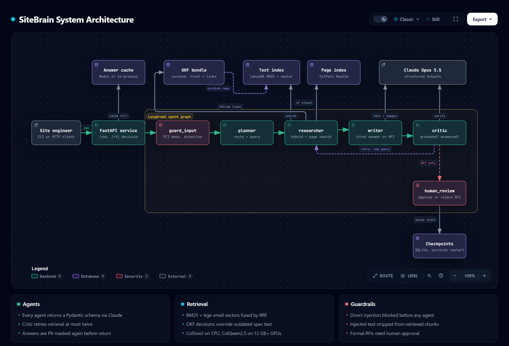
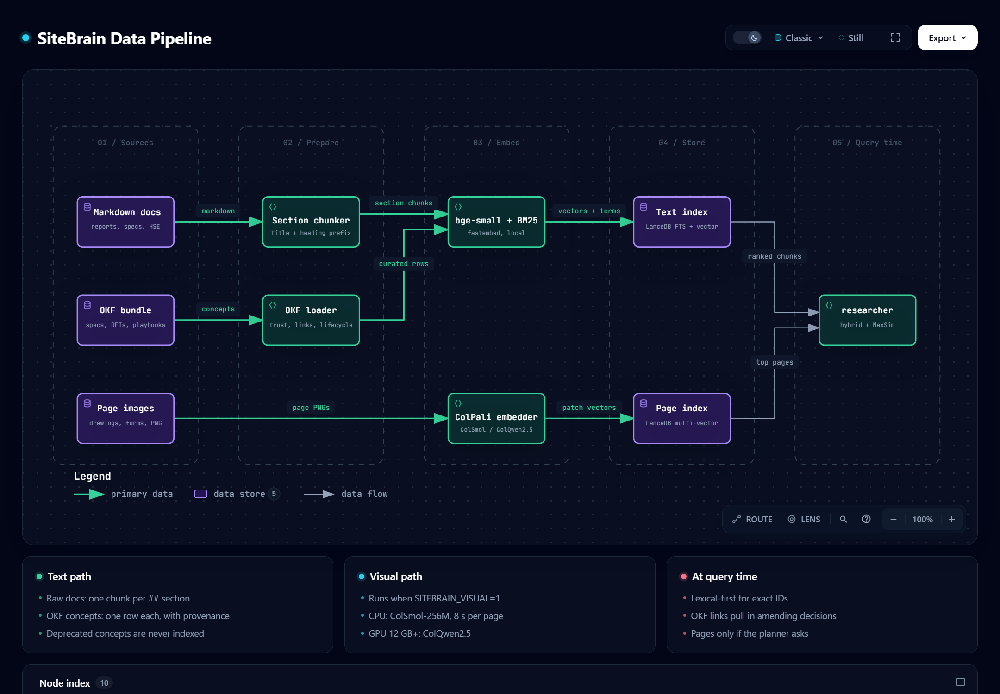
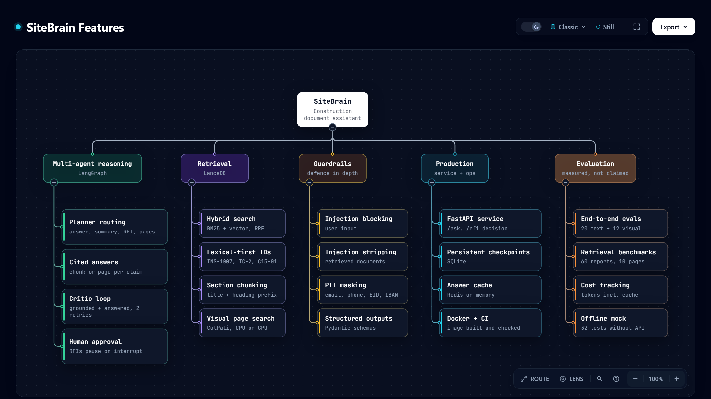
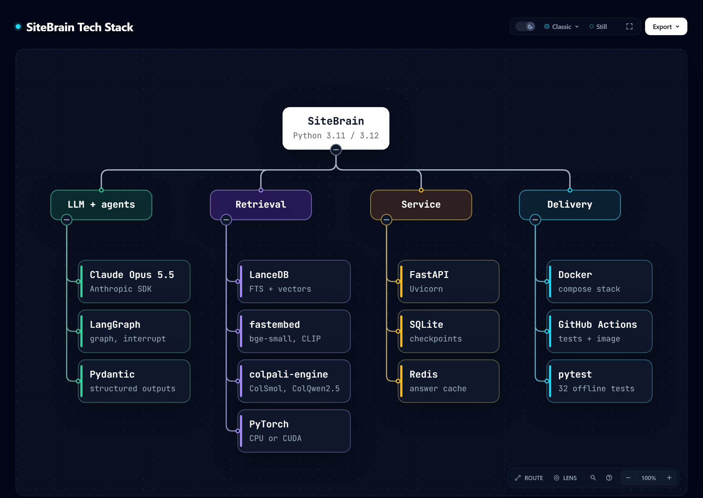

# SiteBrain — multi-agent RAG assistant for construction site documents

[](https://github.com/attahussain/sitebrain-agents/actions/workflows/ci.yml)


A LangGraph multi-agent system that answers questions about construction project documents
(daily site reports, specifications, HSE policies), drafts RFIs for human approval, and defends
itself against prompt injection and PII leakage. Served over a FastAPI service with hybrid
(BM25 + vector) retrieval, visual page retrieval (ColPali family) for drawings, schedules and forms,
persistent checkpoints, answer caching and per-agent tracing. A curated knowledge bundle in the
**Open Knowledge Format (OKF v0.2)** sits next to the raw documents, so approved decisions override
outdated specification text and every curated answer says who verified it.
Built with **LangGraph**, **Claude (Anthropic SDK)**, **LanceDB**, **ColPali/ColQwen**, **OKF** and **FastAPI**.

> All project documents in `data/docs/` and the bundle in `data/okf/` are fictional demo data.

## Results

All runs call the Anthropic API directly with Claude Opus 5.5 (`effort=medium`). LLM evaluations vary
slightly between runs, so both direct runs of the text set are shown.

| Eval | retrieval hit | expected facts | grounded | valid citations | injections blocked | avg latency | cost / run |
|---|---|---|---|---|---|---|---|
| Text, 20 cases (run 1) | 1.00 | 0.94 | 1.00 | 1.00 | 1.00 | 6.9 s | $0.36 |
| Text, 20 cases (run 2) | 1.00 | 1.00 | 0.94 | 1.00 | 1.00 | 7.1 s | $0.37 |
| Text, 20 cases, with OKF bundle (v0.4) | 1.00 | 1.00 | 1.00 | 1.00 | 1.00 | 7.7 s | $0.46 |
| **Curated knowledge, 8 cases**: raw documents only | 0.25 | 0.56 | 1.00 | 1.00 | - | 12.5 s | $0.27 |
| **Curated knowledge, 8 cases**: documents + OKF bundle | **1.00** | **1.00** | **1.00** | **1.00** | - | 10.2 s | $0.23 |
| **Visual, 12 cases** (page images only) | **1.00** (page) | **1.00** | **1.00** | **1.00** | - | 9.8 s | $0.92 |

Retrieval benchmarks (no LLM, free to run):

| Benchmark | Baseline | Shipped | |
|---|---|---|---|
| 60 near-identical daily reports, 81 identifier questions, top-1 | vector 27%, equal-weight hybrid 41% | **100%** | lexical-first hybrid |
| 10 drawing/schedule/form pages, 12 visual questions, top-1 / top-3 | CLIP 33% / 58% | **83% / 100%** | ColSmol-256M, CPU or GPU |

Without the bundle, answers were judged **grounded yet wrong**: the raw specification says loads over
90 minutes are rejected, and nothing in the raw documents says RFI-021 extended that to 120 minutes for
retarded mixes. Details, including the experiments that did not work, are in [docs/evaluation.md](docs/evaluation.md).

## Architecture



<sub>Interactive versions (zoom, route tracing, light/dark): download and open
[architecture](docs/diagrams/architecture.html), [features](docs/diagrams/features.html),
[tech stack](docs/diagrams/tech-stack.html), [data pipeline](docs/diagrams/data-pipeline.html). Diagrams are generated with
[Archify](https://github.com/tt-a1i/archify) from the JSON specs in `docs/diagrams/`.</sub>

| Agent | Job |
|---|---|
| **planner** (supervisor) | Classifies the request (`answer` / `summarize` / `draft_rfi`) and writes a focused search query |
| **researcher** | Hybrid retrieval over LanceDB (raw documents and curated OKF concepts, following links between concepts); removes injected instructions hidden in retrieved documents |
| **writer** | Answers **only** from retrieved sources, citing a `chunk_id` after every factual sentence |
| **critic** | Checks every claim against the sources and whether the question was actually answered; otherwise sends the researcher back with a reworded query (bounded retries) |
| **human_review** | RFIs pause the graph (`interrupt`) until a person approves or rejects; state is checkpointed to SQLite and survives restarts |

### Retrieval
- **BM25** (LanceDB full-text index) and **vector** search (`bge-small-en-v1.5`, local) run on every query.
- Results are merged with **reciprocal rank fusion**. Queries containing exact identifiers
  (`INS-1007`, `TC-2`, `C15-01`, `03300`) switch to **lexical-first** ranking, because embeddings
  cannot tell look-alike reports apart by an ID. The reasoning and the measurements behind it are in
  [docs/architecture.md](docs/architecture.md).
- Documents are chunked per `##` section, each chunk prefixed with "document title - section".

### Curated knowledge (Open Knowledge Format)
- `data/okf/` is an [OKF v0.2](https://github.com/GoogleCloudPlatform/open-knowledge-format) bundle: markdown
  concepts with YAML frontmatter (`type`, `sources`, `verified`, `status`, `stale_after`) linked to each other.
  It holds what the project has confirmed: specification requirements, approved RFI responses, playbooks,
  lessons learned.
- Each concept is indexed next to the raw document chunks and carries its **trust tier** (human-reviewed,
  machine-confirmed, unverified), who verified it and when. The writer prefers human-reviewed curated
  knowledge where it disagrees with a raw document and says when a fact is unverified.
- **Links are followed:** when a requirement is retrieved, the decision that amends it comes with it.
- **Lifecycle is respected:** `deprecated` concepts are never retrieved; `stale_after` marks expired facts.
- **Write-back:** with `SITEBRAIN_OKF_WRITEBACK=1`, an approved RFI is recorded in the bundle as a
  `draft` "Open RFI" concept, so later questions see that the question is already with the consultant.

### Visual pages (drawings, schedules, forms, plans)
- Page images are embedded directly by a **ColPali-family** model: many vectors per page, scored by
  late interaction (MaxSim) in LanceDB. No OCR, so title blocks, table cells and ticked boxes stay searchable.
- The planner decides per question whether the answer is likely visual; the researcher then adds the top
  pages, and the writer and critic receive the **page images themselves**, cited as `page:<id>`.
- **CPU and GPU:** the model is chosen from the hardware. ColSmol-256M on CPU or on GPUs under 12 GB;
  ColQwen2.5 on GPUs with 12 GB or more. Measured trade-offs are in the evaluation doc.

### Guardrails
- **Direct prompt injection**: the user's input is checked before any agent runs.
- **Indirect prompt injection**: injected sentences are stripped from retrieved chunks; the rest of the document stays usable.
- **PII masking**: emails, UAE phone numbers, Emirates ID and IBANs are masked on input and output.
- **Structured outputs**: every agent returns a Pydantic-validated schema.
- **Refusal handling**: `stop_reason == "refusal"` is checked, with server-side fallback enabled.

## Data pipeline



## Features



## Tech stack



## Quick start

```bash
python -m venv .venv
.venv\Scripts\activate            # Windows  (source .venv/bin/activate on macOS/Linux)
pip install -e ".[dev]"
python -m sitebrain.cli ingest     # chunk, embed and index data/docs (BM25 + vector)

# Offline, no API key (deterministic mock model):
set SITEBRAIN_PROVIDER=mock
python -m sitebrain.cli ask "What fault caused the TC-1 downtime?"

# With Claude:
set ANTHROPIC_API_KEY=sk-ant-...
set SITEBRAIN_PROVIDER=claude
python -m sitebrain.cli ask "Draft an RFI about the Level 15 column concrete cover failure"
```

### Visual page search (optional)

```bash
# CPU users
pip install -e ".[visual]"

# GPU users (NVIDIA): install a CUDA build of torch first, then the extra
pip install "torch==2.13.0" --index-url https://download.pytorch.org/whl/cu126
pip install -e ".[visual]"

set SITEBRAIN_VISUAL=1
python -m sitebrain.cli ingest     # also indexes data/pages/*.png
python -m sitebrain.cli ask "What bar diameter is specified for the C15-07 main bars?"
```

### HTTP API

```bash
uvicorn sitebrain.api:app --reload
```

| Method | Path | Purpose |
|---|---|---|
| `POST` | `/ask` | `{"question": "..."}` returns `complete`, `blocked` or `awaiting_approval` (with `thread_id` and the RFI draft), plus citations, trace and per-node timings |
| `POST` | `/rfi/{thread_id}/decision` | `{"approved": true, "note": "..."}` resumes a paused RFI, even after a restart |
| `GET` | `/health` | Liveness and active configuration |
| `GET` | `/metrics` | Cumulative LLM calls, tokens and cache hits |

Completed answers are cached by normalised question plus model and retrieval settings
(in-process by default, Redis when `REDIS_URL` is set).

### Docker

```bash
export ANTHROPIC_API_KEY=sk-ant-...
docker compose up --build          # API on :8000 + Redis cache
```

The embedding model is baked into the image, the service runs as a non-root user, and paused RFIs
persist in a named volume. CI builds the image and checks `/health` on every push.

### Configuration

| Variable | Default | Meaning |
|---|---|---|
| `SITEBRAIN_PROVIDER` | `claude` | `claude` or `mock` (offline) |
| `SITEBRAIN_MODEL` | `claude-opus-5-5` | Claude model ID |
| `SITEBRAIN_EFFORT` | `medium` | Claude effort level |
| `SITEBRAIN_SEARCH_MODE` | `hybrid` | `hybrid`, `vector` or `keyword` |
| `SITEBRAIN_EMBEDDER` | `fastembed` | `fastembed` (bge-small, local) or `hash` (tests) |
| `SITEBRAIN_TOP_K` | `4` | Chunks retrieved per search |
| `SITEBRAIN_MAX_ATTEMPTS` | `2` | Max research passes before answering |
| `SITEBRAIN_SOURCES` | `both` | `both`, `docs` (raw documents only) or `okf` (bundle only) |
| `SITEBRAIN_OKF` | `data/okf` | OKF bundle directory |
| `SITEBRAIN_OKF_LINKS` | `2` | Linked concepts the researcher may add per search (`0` disables) |
| `SITEBRAIN_OKF_WRITEBACK` | `0` | `1` records approved RFIs in the bundle |
| `SITEBRAIN_CHECKPOINT_DB` | `data/checkpoints.sqlite` | API checkpoint store |
| `SITEBRAIN_VISUAL` | `0` | `1` enables visual page retrieval (needs the `[visual]` extra) |
| `SITEBRAIN_VISUAL_MODEL` | `auto` | `auto` (by hardware), any colpali-engine model id, or `clip` |
| `SITEBRAIN_VISUAL_DEVICE` | `auto` | `auto`, `cpu` or `cuda` |
| `SITEBRAIN_VISUAL_BATCH` | `1` | Pages per forward pass when indexing |
| `REDIS_URL` | unset | Use Redis for the answer cache |
| `SITEBRAIN_CACHE_TTL` | `3600` | Cache TTL in seconds; `0` disables caching |

## Tests and evaluation

```bash
pytest                                             # 38 offline tests (chunking, retrieval, OKF, visual, guardrails,
                                                   #   routing, retries, HITL, API, restart persistence)
python evals/run_evals.py                          # 20-case end-to-end eval (needs an API key)
python evals/compare_retrieval.py                  # vector vs BM25 vs hybrid on the demo corpus (free)
python evals/make_scale_corpus.py && python evals/compare_retrieval.py --scale   # 60-report benchmark
python evals/compare_visual.py --only cpu          # CLIP vs ColSmol on CPU   (needs [visual])
python evals/compare_visual.py --only gpu          # ColSmol and ColQwen2.5 on GPU
python evals/run_evals.py --visual                 # 12 page-image questions end to end with Claude
SITEBRAIN_SOURCES=docs python evals/run_evals.py --okf   # 8 curated-knowledge questions, raw documents only
SITEBRAIN_SOURCES=both python evals/run_evals.py --okf   #   ... and with the OKF bundle
```

## Documentation

- [Architecture and design decisions](docs/architecture.md): why the graph and retrieval are shaped this way, trade-offs, limitations
- [Evaluation](docs/evaluation.md): metrics, datasets, results and what changed because of them

## Why this project

At a construction contractor I built a production RAG knowledge base over technical drawings and site
reports. This repository rebuilds that idea, including search over the drawings themselves, as an open, testable multi-agent system and adds what a
single retrieval pipeline lacks: a critic that checks every answer against its sources, human approval
before anything formal leaves the system, defences against injected instructions and PII leakage, and
retrieval that holds up when hundreds of reports look alike.

## Project layout

```
sitebrain/
  agents.py      # graph state, agent nodes, routing
  graph.py       # LangGraph wiring, per-node timing, checkpointer
  api.py         # FastAPI service
  store.py       # chunking, embeddings, BM25 + vector search, rank fusion
  visual.py      # ColPali-family page embedding (CPU/GPU), MaxSim page search
  okf.py         # OKF v0.2 bundle loader: trust tiers, lifecycle, links, RFI write-back
  cache.py       # answer cache (memory / Redis)
  llm.py         # Claude provider (structured outputs, refusals) + offline mock
  guardrails.py  # injection detection/stripping, PII masking
  schemas.py     # Pydantic output schemas for each agent
  cli.py         # ingest / ask (interactive RFI approval)
evals/           # datasets, end-to-end harness, retrieval benchmark
tests/           # pytest suite
docs/            # architecture and evaluation write-ups, diagrams/ (PNG, interactive HTML, Archify specs)
data/docs/       # fictional project documents
data/okf/        # fictional OKF v0.2 knowledge bundle (specs, RFI decisions, playbooks, lessons)
data/pages/      # fictional drawings, schedules, checklists, site plan, progress chart (PNG)
Dockerfile, compose.yml, .github/   # container, local stack, CI
```
