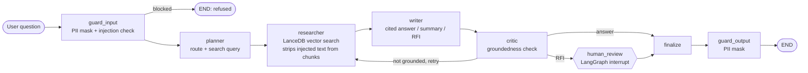

# SiteBrain — multi-agent RAG assistant for construction site documents

[](https://github.com/attahussain/sitebrain-agents/actions/workflows/ci.yml)


A LangGraph multi-agent system that answers questions about construction project documents
(daily site reports, specifications, HSE policies), drafts RFIs for human approval, and defends
itself against prompt injection and PII leakage. Built with **LangGraph**, **Claude (Anthropic SDK)**
and **LanceDB**.

> All project documents in `data/docs/` are fictional demo data.

## Architecture



| Agent | Job |
|---|---|
| **planner** (supervisor) | Classifies the request (`answer` / `summarize` / `draft_rfi`) and writes a focused search query |
| **researcher** | Vector search over LanceDB; removes injected instructions hidden in retrieved documents |
| **writer** | Answers **only** from retrieved sources, citing a `chunk_id` after every factual sentence |
| **critic** | Verifies every claim against the sources; if unsupported, sends the researcher back with a better query (bounded retries) |
| **human_review** | RFIs pause the graph (`interrupt`) until a person approves or rejects; state is checkpointed |

### Guardrails
- **Direct prompt injection**: the user's input is checked before any agent runs.
- **Indirect prompt injection**: retrieved chunks are scanned. Only the injected sentences are removed, so legitimate facts in the same document still answer the question (see `data/docs/supplier_note_untrusted.md`).
- **PII masking**: emails, UAE phone numbers, Emirates ID and IBANs are masked on input and output.
- **Structured outputs**: every agent returns a Pydantic-validated schema (`sitebrain/schemas.py`).
- **Refusal handling**: `stop_reason == "refusal"` is checked, with server-side fallback enabled.

## Quick start

```bash
python -m venv .venv
.venv\Scripts\activate            # Windows  (source .venv/bin/activate on macOS/Linux)
pip install -e ".[dev]"

python -m sitebrain.cli ingest     # chunk + embed docs into LanceDB (local bge-small embeddings)

# Offline demo, no API key needed (deterministic mock model):
set SITEBRAIN_PROVIDER=mock
python -m sitebrain.cli ask "What is the minimum concrete cover for columns?"
python -m sitebrain.cli ask "Draft an RFI about the Level 15 column concrete cover failure"

# Real run with Claude:
set ANTHROPIC_API_KEY=sk-ant-...
set SITEBRAIN_PROVIDER=claude
python -m sitebrain.cli ask "Why did the Level 15 column rebar inspection fail?"
```

| Variable | Default | Meaning |
|---|---|---|
| `SITEBRAIN_PROVIDER` | `claude` | `claude` or `mock` (offline) |
| `SITEBRAIN_MODEL` | `claude-opus-5-5` | Claude model ID |
| `SITEBRAIN_EFFORT` | `medium` | Claude effort level |
| `SITEBRAIN_EMBEDDER` | `fastembed` | `fastembed` (BAAI/bge-small-en-v1.5, local) or `hash` (tests) |
| `SITEBRAIN_TOP_K` | `4` | Chunks retrieved per search |
| `SITEBRAIN_MAX_ATTEMPTS` | `2` | Max research passes before answering |

## Tests and evaluation

```bash
pytest                                        # 17 offline tests: guardrails, routing, HITL pause/resume
python evals/run_evals.py                     # 14-case eval against Claude (needs API key)
set SITEBRAIN_PROVIDER=mock && python evals/run_evals.py   # same eval offline
```

Metrics: retrieval hit rate, answer keyword recall, groundedness rate (critic), citation validity
(no invented sources), direct-injection block rate, indirect-injection quarantine rate, latency, token usage.

**Offline baseline** (mock model + real embeddings, 14 cases):

| retrieval_hit | keyword_recall | grounded | citation_validity | injection_blocked | indirect_quarantined |
|---|---|---|---|---|---|
| 1.00 | 0.92 | 1.00 | 1.00 | 1.00 | 1.00 |

The mock model copies sentences from retrieved chunks, so these numbers measure retrieval and
guardrails, not answer quality. Run the eval with `SITEBRAIN_PROVIDER=claude` for generation metrics.

## Documentation

- [Architecture and design decisions](docs/architecture.md): why the graph is shaped this way, trade-offs, known limitations
- [Evaluation](docs/evaluation.md): metrics, dataset, results and what changed because of them

## Why this project

At a construction contractor I built a production RAG knowledge base over technical drawings and site
reports. This repository rebuilds that idea as an open, testable multi-agent system and adds the parts a
single retrieval pipeline lacks: a critic that checks every answer against its sources, human approval
before anything formal leaves the system, and defences against injected instructions and PII leakage.

## Project layout

```
sitebrain/
  agents.py      # graph state + agent nodes + routing
  graph.py       # LangGraph wiring, checkpointer
  llm.py         # Claude provider (structured outputs, refusals) + offline mock
  guardrails.py  # injection detection/stripping, PII masking
  store.py       # chunking, embeddings, LanceDB search
  schemas.py     # Pydantic output schemas for each agent
  cli.py         # ingest / ask (interactive RFI approval)
evals/           # dataset + harness
tests/           # pytest suite
docs/            # architecture and evaluation write-ups
data/docs/       # fictional project documents
.github/         # CI: offline test suite on Python 3.11 and 3.12
```
