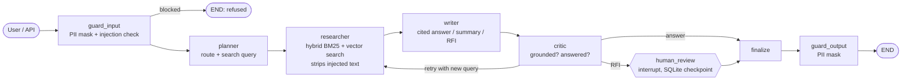

# SiteBrain — multi-agent RAG assistant for construction site documents

[](https://github.com/attahussain/sitebrain-agents/actions/workflows/ci.yml)


A LangGraph multi-agent system that answers questions about construction project documents
(daily site reports, specifications, HSE policies), drafts RFIs for human approval, and defends
itself against prompt injection and PII leakage. Served over a FastAPI service with hybrid
(BM25 + vector) retrieval, persistent checkpoints, answer caching and per-agent tracing.
Built with **LangGraph**, **Claude (Anthropic SDK)**, **LanceDB** and **FastAPI**.

> All project documents in `data/docs/` are fictional demo data.

## Results

Claude Opus 5.5, 20 evaluation cases (13 factual, 1 summary, 1 RFI, 6 exact-identifier questions,
2 direct and 1 indirect prompt injection):

| retrieval hit | answer keyword recall | grounded | valid citations | injections blocked | avg latency |
|---|---|---|---|---|---|
| 1.00 | 1.00 | 1.00 | 1.00 | 1.00 (3/3) | 4.8 s |

Retrieval benchmark on 60 near-identical synthetic daily reports (81 identifier questions, top-1 accuracy):

| vector | BM25 keyword | hybrid, equal-weight RRF | **hybrid, as shipped** |
|---|---|---|---|
| 27% | 100% | 41% | **100%** |

How each number was reached, including the failures along the way, is in [docs/evaluation.md](docs/evaluation.md).

## Architecture



| Agent | Job |
|---|---|
| **planner** (supervisor) | Classifies the request (`answer` / `summarize` / `draft_rfi`) and writes a focused search query |
| **researcher** | Hybrid retrieval over LanceDB; removes injected instructions hidden in retrieved documents |
| **writer** | Answers **only** from retrieved sources, citing a `chunk_id` after every factual sentence |
| **critic** | Checks every claim against the sources and whether the question was actually answered; otherwise sends the researcher back with a reworded query (bounded retries) |
| **human_review** | RFIs pause the graph (`interrupt`) until a person approves or rejects; state is checkpointed to SQLite and survives restarts |

### Retrieval
- **BM25** (LanceDB full-text index) and **vector** search (`bge-small-en-v1.5`, local) run on every query.
- Results are merged with **reciprocal rank fusion**. Queries containing exact identifiers
  (`INS-1007`, `TC-2`, `C15-01`, `03300`) switch to **lexical-first** ranking, because embeddings
  cannot tell look-alike reports apart by an ID. The reasoning and the measurements behind it are in
  [docs/architecture.md](docs/architecture.md).
- Documents are chunked per `##` section, each chunk prefixed with "document title - section".

### Guardrails
- **Direct prompt injection**: the user's input is checked before any agent runs.
- **Indirect prompt injection**: injected sentences are stripped from retrieved chunks; the rest of the document stays usable.
- **PII masking**: emails, UAE phone numbers, Emirates ID and IBANs are masked on input and output.
- **Structured outputs**: every agent returns a Pydantic-validated schema.
- **Refusal handling**: `stop_reason == "refusal"` is checked, with server-side fallback enabled.

## Quick start

```bash
python -m venv .venv
.venv\Scripts\activate            # Windows  (source .venv/bin/activate on macOS/Linux)
pip install -e ".[dev]"
python -m sitebrain.cli ingest     # chunk, embed and index data/docs (BM25 + vector)

# Offline, no API key (deterministic mock model):
set SITEBRAIN_PROVIDER=mock
python -m sitebrain.cli ask "What fault caused the TC-1 downtime?"

# With Claude:
set ANTHROPIC_API_KEY=sk-ant-...
set SITEBRAIN_PROVIDER=claude
python -m sitebrain.cli ask "Draft an RFI about the Level 15 column concrete cover failure"
```

### HTTP API

```bash
uvicorn sitebrain.api:app --reload
```

| Method | Path | Purpose |
|---|---|---|
| `POST` | `/ask` | `{"question": "..."}` returns `complete`, `blocked` or `awaiting_approval` (with `thread_id` and the RFI draft), plus citations, trace and per-node timings |
| `POST` | `/rfi/{thread_id}/decision` | `{"approved": true, "note": "..."}` resumes a paused RFI, even after a restart |
| `GET` | `/health` | Liveness and active configuration |
| `GET` | `/metrics` | Cumulative LLM calls, tokens and cache hits |

Completed answers are cached by normalised question plus model and retrieval settings
(in-process by default, Redis when `REDIS_URL` is set).

### Docker

```bash
export ANTHROPIC_API_KEY=sk-ant-...
docker compose up --build          # API on :8000 + Redis cache
```

The embedding model is baked into the image, the service runs as a non-root user, and paused RFIs
persist in a named volume. CI builds the image and checks `/health` on every push.

### Configuration

| Variable | Default | Meaning |
|---|---|---|
| `SITEBRAIN_PROVIDER` | `claude` | `claude` or `mock` (offline) |
| `SITEBRAIN_MODEL` | `claude-opus-5-5` | Claude model ID |
| `SITEBRAIN_EFFORT` | `medium` | Claude effort level |
| `SITEBRAIN_SEARCH_MODE` | `hybrid` | `hybrid`, `vector` or `keyword` |
| `SITEBRAIN_EMBEDDER` | `fastembed` | `fastembed` (bge-small, local) or `hash` (tests) |
| `SITEBRAIN_TOP_K` | `4` | Chunks retrieved per search |
| `SITEBRAIN_MAX_ATTEMPTS` | `2` | Max research passes before answering |
| `SITEBRAIN_CHECKPOINT_DB` | `data/checkpoints.sqlite` | API checkpoint store |
| `REDIS_URL` | unset | Use Redis for the answer cache |
| `SITEBRAIN_CACHE_TTL` | `3600` | Cache TTL in seconds; `0` disables caching |

## Tests and evaluation

```bash
pytest                                             # 28 offline tests (chunking, retrieval, guardrails,
                                                   #   routing, retries, HITL, API, restart persistence)
python evals/run_evals.py                          # 20-case end-to-end eval (needs an API key)
python evals/compare_retrieval.py                  # vector vs BM25 vs hybrid on the demo corpus (free)
python evals/make_scale_corpus.py && python evals/compare_retrieval.py --scale   # 60-report benchmark
```

## Documentation

- [Architecture and design decisions](docs/architecture.md): why the graph and retrieval are shaped this way, trade-offs, limitations
- [Evaluation](docs/evaluation.md): metrics, datasets, results and what changed because of them

## Why this project

At a construction contractor I built a production RAG knowledge base over technical drawings and site
reports. This repository rebuilds that idea as an open, testable multi-agent system and adds what a
single retrieval pipeline lacks: a critic that checks every answer against its sources, human approval
before anything formal leaves the system, defences against injected instructions and PII leakage, and
retrieval that holds up when hundreds of reports look alike.

## Project layout

```
sitebrain/
  agents.py      # graph state, agent nodes, routing
  graph.py       # LangGraph wiring, per-node timing, checkpointer
  api.py         # FastAPI service
  store.py       # chunking, embeddings, BM25 + vector search, rank fusion
  cache.py       # answer cache (memory / Redis)
  llm.py         # Claude provider (structured outputs, refusals) + offline mock
  guardrails.py  # injection detection/stripping, PII masking
  schemas.py     # Pydantic output schemas for each agent
  cli.py         # ingest / ask (interactive RFI approval)
evals/           # datasets, end-to-end harness, retrieval benchmark
tests/           # pytest suite
docs/            # architecture and evaluation write-ups
data/docs/       # fictional project documents
Dockerfile, compose.yml, .github/   # container, local stack, CI
```
