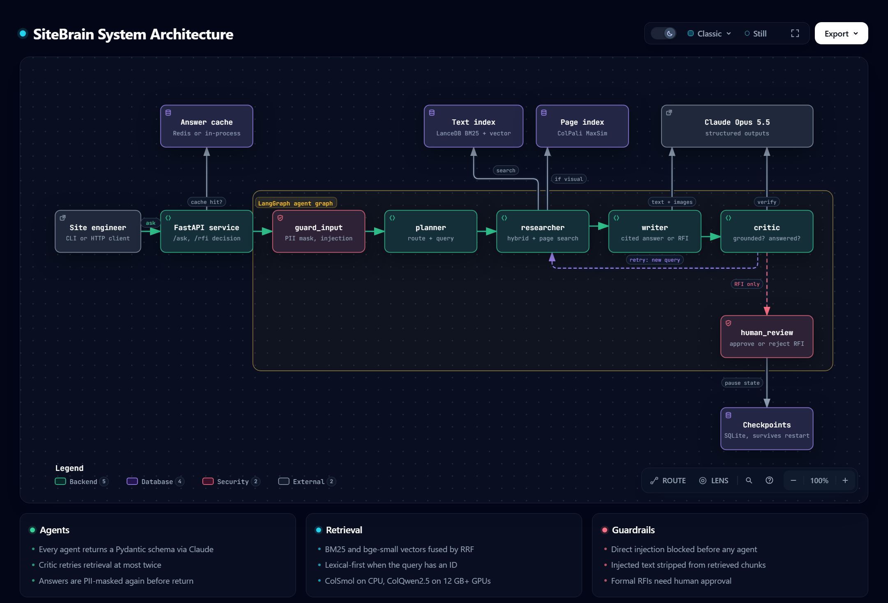

# Architecture and design decisions

## Request lifecycle

1. **guard_input** masks PII in the question, then checks it for prompt-injection patterns. A flagged
   request ends the run before any model is called, so a hostile prompt costs nothing and reaches nothing.
2. **planner** returns a `Plan` (route + search query). Routing is a model decision, but the graph edges
   are fixed in code, so the planner can choose a path, not invent one.
3. **researcher** runs hybrid retrieval (BM25 + vector) over LanceDB and strips injected sentences from each chunk.
4. **writer** produces an `Answer` or an `RFIDraft` from the retrieved chunks only, citing `chunk_id`s.
5. **critic** returns a `Critique`. If the draft is not grounded and the critic suggests a better query,
   the graph loops back to the researcher, up to `SITEBRAIN_MAX_ATTEMPTS` research passes.
6. **human_review** (RFIs only) calls `interrupt()`. The run stops with its state checkpointed and resumes
   when the caller sends `Command(resume={"approved": ..., "note": ...})`.
7. **finalize** and **guard_output** assemble the result and mask any PII that came from the documents.

## Decisions and trade-offs

**Fixed graph, model-chosen route.** A free-form agent loop could decide its own next step, but every
path here is reviewable in `graph.py`, which matters when the output is a formal RFI to a consultant.
The cost is flexibility: a new capability means a new node and edge, not a new prompt.

**Bounded critic loop.** An unbounded generate/critique loop can spin on a question the documents cannot
answer. After the last attempt the answer is returned with a visible caution instead of looping again.

**Grounded is not the same as answered.** "The sources do not say" is a perfectly grounded sentence, and
the first critic accepted it, so a retrieval miss ended the run without a second search. The critic now
returns `answered` alongside `grounded`, and either failing triggers a retry with a reworded query.

**Section-level chunks with a context prefix.** Packing paragraphs into fixed-size chunks put a scaffold
rule and three heat-stress rules into one vector, and the scaffold rule became unfindable. Each `##`
section is now its own chunk, prefixed with "document title - section heading" so the embedding and the
writer both see where the text came from.

**Strip injected sentences instead of dropping the chunk.** The first version discarded any chunk that
contained an injection. The evaluation showed the cost: the poisoned supplier note was also the only
source of the delivery window, so the system could no longer answer that question. Removing only the
offending sentences keeps the legitimate facts and still keeps the instruction away from every model.

**Regex guardrails, deliberately simple.** Pattern matching is fast, free and testable, and it catches the
common phrasings. It will not catch paraphrased or encoded attacks. Production would add a classifier
(or an LLM judge) behind the regex and keep the regex as the cheap first layer.

**PII masked on both sides.** Input masking keeps personal data out of prompts; output masking covers
personal data that lives in the documents themselves (the site engineer's contact details in the
12 Oct report).

**Structured outputs everywhere.** Each agent returns a Pydantic model enforced by the API's
structured-output support, so the graph never parses free text to find a route or a verdict.

**Hybrid retrieval, lexical-first for identifiers.** Vector search finds "how long must concrete
cure" without the word "cure" in the text; BM25 finds "INS-1007" exactly. Both run on every query.
On a benchmark of 60 near-identical daily reports, the obvious design, equal-weight reciprocal rank
fusion, was worse than BM25 alone (41% vs 100% top-1): vector search was close to random there
(27%), and RRF gave its noise an equal vote. Weighting the vector list down to 0.25 only reached 56%,
because RRF scores at the top are nearly flat: rank 1 and rank 2 differ by 1/61 - 1/62, about 0.0003,
so even a small vector vote reorders them. Tuning the weight further would have been fitting the
benchmark. The shipped rule expresses the intent directly: if the query contains an identifier
(letters and digits joined by hyphens, or a 4+ digit number) and BM25 returns matches, use BM25 order
and back-fill with vector hits; otherwise fuse with plain RRF.

**Persistent checkpoints for the API.** The CLI keeps graph state in memory. The API uses a SQLite
checkpointer, so an RFI that is waiting for a human survives a process restart; a test starts an RFI,
discards the app, builds a new one on the same file and approves it.

**Answer cache keyed on settings, not just the question.** The key includes provider, model, effort,
search mode and top-k, so changing any of them cannot serve a stale answer. RFIs and blocked requests
are never cached. Redis is used when configured so replicas share hits.

**Per-node timing.** Each node is wrapped to record its wall-clock time; the API returns the list with
every answer. The human-review node is excluded because its duration is a person's response time.

**Visual pages as images, not OCR text.** Drawings, schedules and forms lose most of their meaning when
flattened to text. ColPali-family models embed each page image as one vector per patch and score a query
by late interaction (MaxSim), which LanceDB supports natively for multi-vector columns. The planner decides
per question whether pages are needed (a schema field, so the decision is explicit and testable), and the
writer and critic receive the page images themselves, so the critic can verify a claim against the drawing.

**Model chosen from the hardware.** The same feature has to work on a laptop CPU and on a GPU. ColSmol-256M
matched the larger model's top-3 accuracy on CPU, at 8 s per page to index. ColQwen2.5 was the most
accurate but nearly filled an 8 GB card with its weights alone, which made indexing 30x slower than
ColSmol on the same GPU. `auto` uses ColQwen2.5 only with at least 12 GB of VRAM. Any model can be forced
with `SITEBRAIN_VISUAL_MODEL`.

**Local embeddings.** `BAAI/bge-small-en-v1.5` via fastembed runs on CPU, costs nothing per query and keeps
document text inside the machine during indexing. LanceDB stores vectors and metadata in one embedded
table, with no server to run.

**Mock provider.** `MockLLM` is extractive and deterministic. It lets the tests, the CI pipeline and the
retrieval/guardrail metrics run without an API key. It says nothing about answer quality; that is what
the Claude evaluation run is for.

## Known limitations

- SQLite checkpoints suit one API instance. Several replicas would need a shared checkpointer (Postgres).
- The identifier rule is a regular expression. Identifiers in other formats (for example "Grid line B")
  fall back to plain fusion.
- The scale benchmark is synthetic. It reproduces the template repetition of real daily reports but not
  their messiness (typos, scanned PDFs, tables).
- Prompt-injection stripping works on text. Instructions rendered inside a page image cannot be removed by
  pattern matching; the writer prompt tells the model to treat all source content as data, which is a
  weaker defence.
- Visual answers cite whole pages, not regions of a page.
- Visual search runs only when the planner asks for it, so a misrouted question can miss a relevant page.
- Chunking is section-based. Long tables and drawings (the original use case) need layout-aware parsing.
- The evaluation set is 14 cases over 6 short documents: enough to catch regressions, not to claim accuracy.
- The critic is the same model family as the writer, so it can share the writer's blind spots.
